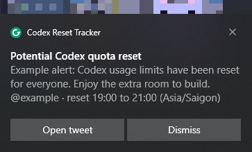
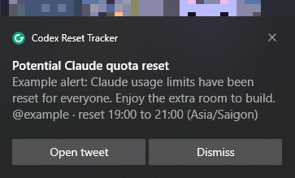

# Codex Reset Tracker

Watch trusted X/Twitter accounts for fresh `reset` posts (Codex and Claude usage
limits) and notify you by Telegram or a desktop popup.

| Area | Default |
| --- | --- |
| Package runner | `uv` |
| Scraper | [Twikit](https://github.com/d60/twikit) |
| Match rule | `reset`, `resets`, `resetting`, `resetted` |
| Trust rule | tweet author must be in `polling.accounts` |
| User timezone | auto-detected from the current machine unless overridden |
| Source timezone | per-account, used for phrases like `this evening` |

## Quick Start

```bash
git clone https://github.com/vTuanpham/codex-reset-tracker.git
cd codex-reset-tracker
./install.sh
uv run codex-reset-tracker init-config   # writes config.json from config.example.json
```

Then:

1. Connect Telegram with `uv run codex-reset-tracker telegram` (or set `channels.desktop.enabled`
   in `config.json` for a desktop popup) and review `polling.accounts`.
2. Save your X cookies as `data/x_cookies.json` (see X/Twitter Auth).

```bash
uv run codex-reset-tracker doctor
uv run codex-reset-tracker test-notify
uv run codex-reset-tracker check
uv run codex-reset-tracker run
```

The first `check` is a baseline pass by default. Keep `run` going to catch newly
discovered tweets, or install the background service below.

## X/Twitter Auth

Cookies are strongly preferred. X/Twitter often blocks automated
username/password login with Cloudflare.

| Path | When to use | Setup |
| --- | --- | --- |
| Browser cookies | Recommended | export x.com cookies to `data/x_cookies.json` |
| Username/password | Fallback only | set `CODQ_X_USERNAME` and `CODQ_X_PASSWORD` in `.env` |
| TOTP secret | Only if authenticator-app 2FA is enabled | set `CODQ_X_TOTP_SECRET` |

Cookie steps:

1. Install [Cookie-Editor (Chrome Web Store)](https://chromewebstore.google.com/detail/cookie-editor/ookdjilphngeeeghgngjabigmpepanpl?hl=en-US&utm_source=ext_sidebar).
2. Open `https://x.com` and log in.
3. Click Cookie-Editor while on `x.com`, export the JSON, and save it as `data/x_cookies.json`.

Do not commit or share `data/x_cookies.json`; it can grant access to your X
session.

## Notifications

| Channel | Best for | Setup |
| --- | --- | --- |
| Desktop | active workstation popup | `channels.desktop.enabled: true` |
| Telegram | fastest mobile alert | `uv run codex-reset-tracker telegram` |
| stdout | logs and testing | `channels.stdout.enabled: true` |

Telegram: message `@BotFather`, send `/newbot`, then run one command:

```bash
uv run codex-reset-tracker telegram
```

It asks for the bot token (hidden), waits while you send the bot any message,
reads your chat id from Telegram, saves both to `.env`, turns the channel on in
`config.json` and sends a confirmation. Restart the service afterwards
(`service restart`).

Desktop: on Windows and in WSL this is a toast under its own "Codex Reset
Tracker" name, showing the tweet's words, the author and the reset window, with an
Open tweet button (WSL forwards it to Windows through `powershell.exe`). On Linux it
uses `notify-send`, on macOS `osascript`.

Sample alerts (the title names the product the tweet is about):

| Telegram | Windows toast, Codex | Windows toast, Claude |
| --- | --- | --- |
|  |  |  |

## Accounts

Only authors listed in `polling.accounts` can alert. Every tweet is checked
locally; results from other accounts are recorded as `untrusted_author` and do
not notify. Edit the list in `config.json`. The defaults cover official accounts
and developer-facing people from OpenAI and Anthropic:

| Group | Handles |
| --- | --- |
| OpenAI official | `@OpenAI`, `@OpenAIDevs` |
| OpenAI people | `@sama`, `@gdb`, `@markchen90`, `@nickaturley`, `@kevinweil` |
| OpenAI Codex | `@thsottiaux`, `@embirico`, `@hansonwng`, `@katyhshi` |
| Anthropic official | `@AnthropicAI`, `@claudeai`, `@ClaudeDevs` |
| Anthropic people | `@DarioAmodei`, `@DanielaAmodei`, `@jackclarkSF`, `@mikeyk`, `@ch402` |
| Claude Code | `@bcherny` |

An account X reports as suspended or nonexistent is skipped for a day after one
warning; remove it from the list when you see that.

## Timezones

| Timezone | Purpose | Default |
| --- | --- | --- |
| User timezone | where alert windows are shown | `auto` |
| Source timezone | how tweet phrases are interpreted | per account |

Example: if `@thsottiaux` says `this evening`, the phrase is interpreted in
`America/Los_Angeles`, then translated to your detected local timezone.

A zone named in the tweet (`3pm PT`, `15:00 UTC`, `Friday evening ET`) beats the
account's default. The time phrases it understands:

| Kind | Examples |
| --- | --- |
| Relative | `in an hour`, `in a couple of hours`, `in 2-3 hours`, `within the hour`, `in the next few hours`, `any minute now` |
| Clock | `at 3pm PT`, `15:00 UTC`, `by noon`, `at midnight`, `tomorrow at 9am`, `Friday 10am`, `between 3 and 5pm ET` |
| Part of day | `tonight`, `this evening`, `tomorrow morning`, `Friday evening`, `later today`, `by EOD` |
| Whole day | `on Monday`, `tomorrow`, `this weekend`, `next week` (low confidence) |
| Already done | `we just reset`, `resetting now`, `reset as of 10:00 UTC`: shown as live now |

Denials such as `no reset today` or `we won't be resetting` do not alert (an
`exclude_patterns` entry in `config.json`).

Override your timezone only when needed:

```json
{
  "local_timezone": "Asia/Saigon",
  "time": {
    "user_timezone": "Asia/Saigon"
  }
}
```

## Background Service

```bash
uv run codex-reset-tracker service install
uv run codex-reset-tracker service start
uv run codex-reset-tracker service status
uv run codex-reset-tracker service logs
```

It runs through `systemd --user`, gets restart handling, and writes logs to the
user journal. For one-off testing run `uv run codex-reset-tracker run` in the
foreground and `uv run codex-reset-tracker status` for the last scan.

### Optional WSL Auto-Start

To start the tracker after Windows logon, unlock or wake, install the Windows
scheduled-task bridge:

```bash
uv run codex-reset-tracker windows-startup install --force
uv run codex-reset-tracker windows-startup status
```

The task wakes WSL and starts the `service`. It runs through
`conhost.exe --headless`, so no console window appears; re-run the install
with `--force` to update an older task that opens one. If distro detection
fails, pass `--distro Ubuntu`.

## Diagnostics

A historical scan, without touching production state or sending real
notifications:

```bash
uv run codex-reset-tracker debug-scan --account thsottiaux --dump-stream data/runtime/debug-scan.jsonl
```

Run tests:

```bash
uv run ruff check .
uv run python -m unittest discover -s tests
```

## Runtime Notes

| Topic | Detail |
| --- | --- |
| Fresh tweets | first-ever scan baselines visible tweets; restarts catch up since the last scan, capped at 24 hours |
| Rate limits | default polling is 20 minutes plus jitter |
| Twikit patches | compatibility monkeypatch registry lives in `src/codex_reset_tracker/twikit_compat.py` |
| State | SQLite tracks seen tweet ids and alerted text hashes |
| Secrets | `.env`, `data/`, cookies, and local DBs are git-ignored |
